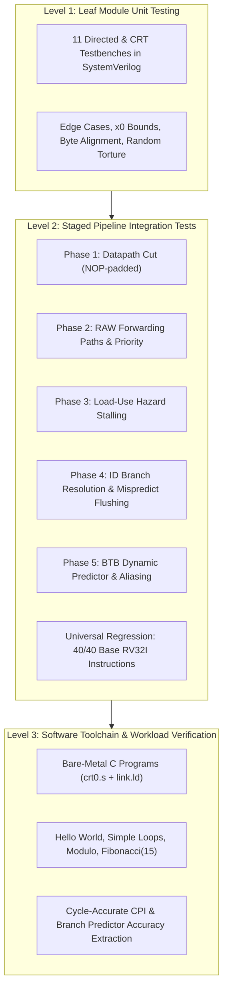
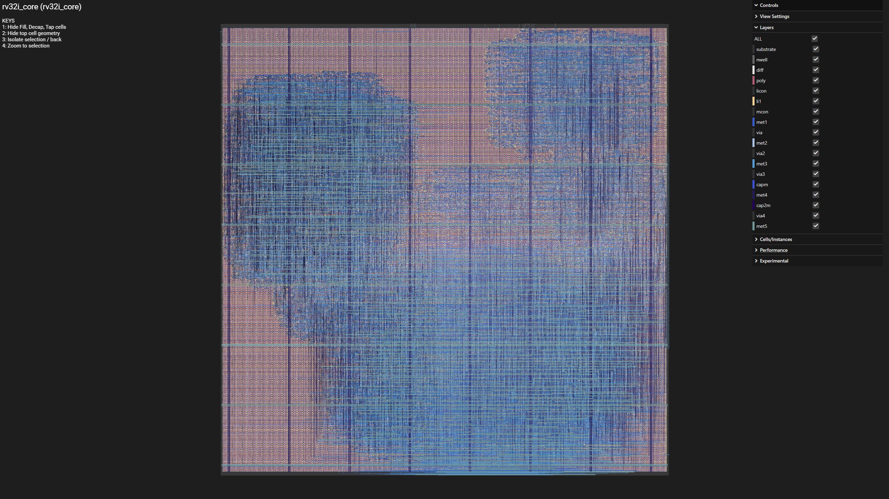

# RV32I Pipelined CPU — RTL Verification & Simulation Infrastructure

[](LICENSE)
[](https://riscv.org/)
[-orange.svg)]()
[](https://github.com/steveicarus/iverilog)
[-brightgreen.svg)]()
[](https://github.com/tanyaverma20)
[](https://github.com/The-OpenROAD-Project/OpenLane)

**Maintainer & Verification Author:** [Tanya Verma](https://github.com/tanyaverma20)<br>
**Repository:** [https://github.com/tanyaverma20/RV32I-Pipelined-CPU](https://github.com/tanyaverma20/RV32I-Pipelined-CPU)<br>
**Base Processor Architecture:** [Zhiyuan (Jerry) Jiang](https://github.com/JerryJiang777) (Apache-2.0 License)

---

## Overview

**RV32I Pipelined CPU — RTL Verification & Simulation Infrastructure** is a verified 5-stage pipelined 32-bit RISC-V microprocessor core accompanied by a standalone, automated Electronic Design Automation (EDA) verification framework. The project emphasizes RTL simulation semantics, IEEE 1800-2012 SystemVerilog compliance, cycle-accurate microarchitectural hazard analysis, and cross-platform regression automation.

The repository features:
- **Core Microarchitecture:** Synthesizable in-order 5-stage pipeline (`IF` $\to$ `ID` $\to$ `EX` $\to$ `MEM` $\to$ `WB`) with 1-cycle decode-stage branch resolution, a 64-entry 2-bit bimodal branch target buffer (BTB), three-tier operand forwarding, and hardware load-use hazard stalling.
- **Verification & Automation Infrastructure:** A unified self-checking SystemVerilog testbench (`tb_soc_top.sv`) with dynamic firmware loading and architectural assertion decoding, driven by an automated Python regression harness (`run_regression.py`) validating 21 test suites in under 18 seconds.
- **Bare-Metal Software Co-Design:** End-to-end GNU toolchain flow (`riscv64-unknown-elf-gcc`, `crt0.s`, custom Harvard linker script `link.ld`) compiling and running real C workloads, including recursive Fibonacci and stress loops.
- **Physical Feasibility:** Fully synthesized, placed, and routed via OpenLane2 on the SkyWater 130nm PDK at 50 MHz with zero timing violations.

---

## Architecture Visual Overview


*Figure 1: Complete microarchitecture datapath of `soc_top` and `rv32i_core`, illustrating pipeline registers, hazard detection, forwarding muxes, branch target buffer, and memory interfaces.*

---

## Table of Contents

- [Motivation & Learning Objectives](#motivation--learning-objectives)
- [Key Features](#key-features)
- [Microarchitecture & Pipeline Specification](#microarchitecture--pipeline-specification)
- [Hazard Handling & Data Forwarding](#hazard-handling--data-forwarding)
- [Branch Prediction & BTB Architecture](#branch-prediction--btb-architecture)
- [Repository Structure](#repository-structure)
- [EDA Technology Stack & Toolchain](#eda-technology-stack--toolchain)
- [Quick Start: Simulation & Regression](#quick-start-simulation--regression)
- [Verification Methodology & Test Coverage](#verification-methodology--test-coverage)
- [Empirical Results & Benchmark Measurements](#empirical-results--benchmark-measurements)
- [Engineering Challenges & Bug Fixes](#engineering-challenges--bug-fixes)
- [Physical Implementation (ASIC & FPGA)](#physical-implementation-asic--fpga)
- [Known Limitations & Roadmap](#known-limitations--roadmap)
- [Maintainer, Provenance & Engineering Contributions](#maintainer-provenance--engineering-contributions)
- [References & License](#references--license)

---

## Motivation & Learning Objectives

This project serves as a practical, production-level exploration of computer architecture, RTL design, and verification infrastructure. As a Computer Engineering student at Thapar Institute of Engineering and Technology preparing for the **Siemens EDA Student Intern — Software Profile**, the primary focus of this work is:

1. **EDA Simulation & Elaboration Semantics:** Investigating HDL simulation engines (Icarus Verilog, Verilator, Questa), understanding symbol resolution in IEEE 1800-2012 SystemVerilog, event-driven scheduling, and lint/elaboration error resolution.
2. **Hardware/Software Co-Verification:** Bridging GCC compiler toolchains (`riscv64-unknown-elf-gcc`, custom linkers, `crt0.s` runtime assembly) with RTL event-driven testbenches and automated test harnesses.
3. **Pipelining & Microarchitectural Hazard Control:** Implementing and auditing hazard detection units, multi-tier stalling, speculative branch execution, and three specialized operand forwarding paths.
4. **Software Engineering & Automation for EDA:** Designing cross-platform, automated regression test suites in Python and SystemVerilog that provide diagnostic error decoding, cycle-accurate metrics (CPI, branch accuracy), and repeatable test results.

---

## Key Features

- **Full RV32I Base Integer ISA Coverage:** Implements all 40 unprivileged RV32I instructions:
  - *ALU Register-Immediate (9):* `ADDI`, `SLTI`, `SLTIU`, `ANDI`, `ORI`, `XORI`, `SLLI`, `SRLI`, `SRAI`
  - *ALU Register-Register (10):* `ADD`, `SUB`, `SLL`, `SLT`, `SLTU`, `SRL`, `SRA`, `XOR`, `OR`, `AND`
  - *Upper Immediate (2):* `LUI`, `AUIPC`
  - *Load Operations (5):* `LB`, `LH`, `LW`, `LBU`, `LHU` (with byte-alignment load filter and sign extension)
  - *Store Operations (3):* `SB`, `SH`, `SW` (with byte/halfword masking and lane shifting)
  - *Control Flow / Jumps (2):* `JAL`, `JALR`
  - *Conditional Branches (6):* `BEQ`, `BNE`, `BLT`, `BGE`, `BLTU`, `BGEU`
  - *System & Synchronization (3):* `ECALL`, `EBREAK` (hardware execution halt), `FENCE` (NOP fallback)
- **Classic 5-Stage In-Order Pipeline:** Decoupled `IF` $\to$ `ID` $\to$ `EX` $\to$ `MEM` $\to$ `WB` execution datapath with synchronous pipeline registers (`if_id_reg`, `id_ex_reg`, `ex_mem_reg`, `mem_wb_reg`).
- **Low-Latency ID-Stage Branch Resolution:** Branch decision and target calculation resolved in the `ID` stage rather than `EX`, reducing misprediction penalty from 2 cycles down to **1 cycle**.
- **Dynamic Branch Prediction:** 64-entry, direct-mapped Branch Target Buffer (BTB) indexed by `PC[7:2]` with 24-bit address tag matching and 2-bit saturating bimodal counters (`strongly not-taken` $\to$ `strongly taken`).
- **Comprehensive Operand Forwarding:**
  - `EX/MEM` $\to$ `EX` and `MEM/WB` $\to$ `EX` forwarding for arithmetic dependencies (`forwarding_unit.v`).
  - `EX` (unlatched) $\to$ `ID` and `EX/MEM` $\to$ `ID` forwarding for early branch comparator resolution (`id_forwarding_unit.v`).
  - `MEM/WB` $\to$ `MEM` store-data forwarding for back-to-back load-store sequences (`mem_forwarding_unit.v`).
  - Same-cycle write-first / read-second internal register file bypass (`reg_file.v`).
- **Two-Tier Load-Use Hazard Detection:** Hardware stall generation freezing `PC` and `IF/ID` while bubbling `ID/EX` for:
  - Load followed immediately by an ALU consumer (1 stall cycle).
  - Load followed immediately by a branch consumer in ID (2 stall cycles).
- **Two-Stage Hardware Retirement Halt:** Sticky decode freeze latch (`halted`) prevents speculative over-fetching upon `ECALL`/`EBREAK`, while a retirement latch (`fully_halted`) asserts only when the halt instruction traverses `WB`, guaranteeing pipeline drain.

---

## Microarchitecture & Pipeline Specification

```mermaid
flowchart LR
    subgraph IF [Stage 1: Fetch (IF)]
        PC["Program Counter"] --> IROM["Instruction Memory (ROM)"]
        PC --> BTB["64-Entry BTB / 2-bit Predictor"]
        BTB -.->|"Speculative Target"| PC
    end

    IF -->|"IF/ID Register (Freeze / Flush)"| ID

    subgraph ID [Stage 2: Decode & Early Branch (ID)]
        CU["Control Unit"]
        RF["Register File (32 x 32)"]
        IG["Immediate Generator"]
        BC["Branch Comparator"]
        BTA["Branch Target Adder"]
        IDF["ID Forwarding Unit"]
        BC -.->|"Mispredict Detect / 1-cycle Flush"| PC
    end

    ID -->|"ID/EX Register (Bubble)"| EX

    subgraph EX [Stage 3: Execute (EX)]
        ALU["32-bit ALU"]
        ALUC["ALU Control"]
        FWD["EX Forwarding Unit"]
        ACT["mem_to_reg Result Resolution"]
    end

    EX -->|"EX/MEM Register"| MEM

    subgraph MEM [Stage 4: Memory Access (MEM)]
        DRAM["Data Memory (RAM)"]
        LF["Load Filter (Sign/Zero Ext)"]
        SM["Store Mask & Alignment"]
        MFW["MEM Store Forwarding Unit"]
    end

    MEM -->|"MEM/WB Register"| WB

    subgraph WB [Stage 5: Writeback (WB)]
        WBMUX["Writeback MUX (2-Way)"]
        HLT["Retirement Halt Latch"]
        WBMUX -.->|"Write Data"| RF
    end
```

### Stage Functional Breakdown

| Pipeline Stage | Active Hardware Modules | Key Operations |
|---|---|---|
| **Instruction Fetch (IF)** | `pc.v`, `instruction_mem.v`, `branch_predictor.v` | Increments PC by 4 or consults BTB for predicted branch target; fetches 32-bit instruction word from ROM; supports stall freeze. |
| **Instruction Decode (ID)** | `control_unit.v`, `imm_gen.v`, `reg_file.v`, `branch_comp.v`, `id_forwarding_unit.v`, `halt_latch.v` | Decodes opcode/funct3/funct7; generates immediate offsets; reads register operands; evaluates conditional branches and JAL/JALR targets; generates 1-cycle pipeline flush on misprediction. |
| **Execute (EX)** | `alu.v`, `alu_control.v`, `forwarding_unit.v` | Computes arithmetic, logic, shifts, and memory effective addresses; selects forwarded operands from EX/MEM or MEM/WB; resolves early writeback values. |
| **Memory Access (MEM)** | `data_mem.v`, `load_filter.v`, `store_mask.v`, `mem_forwarding_unit.v` | Reads/writes 32-bit RAM with byte/halfword alignment masking; applies sign/zero extension to load data; forwards writeback data to store-data operand. |
| **Write Back (WB)** | `mem_wb_reg.v`, `halt_latch.v`, internal bypass | Muxes memory load data vs. ALU/immediate/link actual result; writes target register $rd \ne x0$; asserts external `halt` signal upon retirement. |

---

## Hazard Handling & Data Forwarding

### 1. Data Hazards (Read-After-Write)

Operand dependencies are forwarded across stages without inserting bubbles whenever the producing instruction has computed its result:

| Forwarding Unit | Destination / Consumer | Producer Candidates | Addressed Dependency |
|---|---|---|---|
| **`forwarding_unit.v`** | ALU inputs in `EX` | `EX/MEM`, `MEM/WB` | Back-to-back ALU-to-ALU operations (`ADD x1, x2, x3` followed by `SUB x4, x1, x5`). Prioritizes `EX/MEM` over `MEM/WB`. |
| **`id_forwarding_unit.v`** | `branch_comp` & `jalr` target in `ID` | `EX` (unlatched), `EX/MEM` | Early branch resolution in ID consuming a live ALU calculation still in `EX` or `MEM`. |
| **`mem_forwarding_unit.v`** | Store data in `MEM` (`store_mask.v`) | `MEM/WB` | `LW` immediately followed by `SW` writing the same register to memory. |
| **Register File Internal Bypass** | Register read in `ID` | Writeback in `WB` | Producer writing $rd$ and consumer reading $rs$ on the exact same clock edge. |

> [!NOTE]
> All forwarding comparator paths explicitly check `rd != 5'd0`, strictly preserving the hardwired zero invariant of register `x0`.

### 2. Load-Use Data Hazards

Because load data is not retrieved until the end of the `MEM` stage, an instruction that immediately consumes a loaded register cannot be forwarded immediately:

$$\text{Load in EX} \implies \text{Result ready at end of MEM} \implies \text{Requires 1-cycle stall bubble}$$

`hazard_unit.v` monitors `id_ex_mem_read`:
1. **ALU Consumer in ID:** Freezes `PC` and `if_id_reg`, injects a bubble into `id_ex_reg`. In the next cycle, the load advances to `MEM`, and normal EX forwarding supplies the operand.
2. **Branch Consumer in ID:** Because branch comparison occurs early in `ID`, if the load is in `EX` or `MEM`, the hazard unit injects up to 2 stalls until the load completes `MEM`.

---

## Branch Prediction & BTB Architecture

The core incorporates a direct-mapped **Branch Target Buffer (BTB)** integrated with **2-bit saturating bimodal counters**:

```
Fetch PC: [31 ............................ 8] [7 ...... 2] [1 .. 0]
                         Tag (24 bits)          Index (6)    Byte Offset
                                                   |
                                            +------v------+
                                            | 64 Entries  |
                                            | [V|Tag|Tgt|C]|
                                            +------+------+
```

- **Table Organization:** 64 entries indexed by `fetch_pc[7:2]`.
- **Tag Validation:** 24-bit tag `fetch_pc[31:8]` verified against stored tag to eliminate index aliasing false-positives.
- **State Machine:** 2-bit counter with saturating transitions:
  - `00`: Strongly Not-Taken
  - `01`: Weakly Not-Taken
  - `10`: Weakly Taken
  - `11`: Strongly Taken
- **Misprediction Recovery:**
  - Evaluated in `ID`: $\text{mispredicted} = (\text{predicted\_taken} \ne \text{real\_taken}) \lor (\text{taken} \land \text{predicted\_target} \ne \text{real\_target})$.
  - On misprediction: asserts `flush = !stall && mispredicted`, clearing the wrong-path instruction fetched in `IF/ID`, and redirects `pc_next` to the correct branch destination in **1 penalty cycle**.

---

## Repository Structure

```
RV32I-Pipelined-CPU/
├── rtl/                        # Synthesizable RTL design source files
│   ├── alu.v                   # 32-bit arithmetic logic unit
│   ├── alu_control.v           # ALU operation decoder
│   ├── branch_comp.v           # Branch comparison logic (signed/unsigned)
│   ├── branch_predictor.v      # 64-entry BTB with 2-bit saturating counters
│   ├── control_unit.v          # Main opcode instruction decoder
│   ├── data_mem.v              # 4 KB synchronous RAM with byte enables
│   ├── ex_mem_reg.v            # EX/MEM pipeline stage register
│   ├── forwarding_unit.v       # EX-stage RAW operand forwarding unit
│   ├── halt_latch.v            # Sticky halt synchronization latches
│   ├── hazard_unit.v           # Load-use stall detection logic
│   ├── id_ex_reg.v             # ID/EX pipeline stage register
│   ├── id_forwarding_unit.v    # ID-stage branch operand forwarding unit
│   ├── if_id_reg.v             # IF/ID pipeline stage register
│   ├── imm_gen.v               # Immediate value sign/zero unpacker
│   ├── instruction_mem.v       # 4 KB asynchronous ROM
│   ├── load_filter.v           # Load alignment and byte/halfword sign-extension
│   ├── mem_forwarding_unit.v   # MEM-stage store-data forwarding unit
│   ├── mem_wb_reg.v            # MEM/WB pipeline stage register
│   ├── pc.v                    # Program Counter register with freeze support
│   ├── reg_file.v              # 32x32 register file with internal WB bypass
│   ├── rv32i_core.v            # Top-level CPU core pipeline datapath
│   ├── soc_top.v               # Top-level SoC wrapping core, ROM, and RAM
│   └── store_mask.v            # Store lane shift and byte/halfword mask unit
├── sim/                        # Simulation testbenches, makefiles, and automation
│   ├── run_regression.py       # Unified automated Python regression runner
│   ├── c_hello_world/          # Compiled C benchmark: Hello World (1+2=3)
│   ├── fib/                    # Compiled C benchmark: Recursive Fibonacci(15)
│   ├── loop1/ .. loop4/        # Compiled C benchmark loop suites
│   ├── phase_1/ .. phase_5/    # Per-phase Cocotb build & GTKWave setup files
│   └── sc_soc_test/            # Single-cycle backward-compatibility test suite
├── tb/                         # Verification testbenches and program binaries
│   ├── modules/                # 11 Submodule SystemVerilog directed testbenches
│   │   ├── tb_alu.sv           # ALU 10k CRT + directed testbench
│   │   ├── tb_alu_control.sv   # ALU decoder testbench
│   │   ├── tb_branch_comp.sv   # Branch comparator testbench
│   │   ├── tb_control_unit.sv  # Control unit testbench
│   │   ├── tb_data_mem.sv      # Data RAM testbench
│   │   ├── tb_imm_gen.sv       # Immediate generator testbench
│   │   ├── tb_instruction_mem.sv# Instruction ROM self-checking testbench
│   │   ├── tb_load_filter.sv   # Load filter testbench
│   │   ├── tb_pc.sv            # Program counter testbench (with stall freeze)
│   │   ├── tb_reg_file.sv      # Register file 1k CRT torture testbench
│   │   └── tb_store_mask.sv    # Store mask testbench
│   ├── programs/               # Pre-compiled .elf, .s, and .hex test binaries
│   │   ├── phase_1.hex .. phase_5.hex  # Staged pipeline capability programs
│   │   ├── tb_top_soc.hex      # Universal comprehensive self-checking program
│   │   └── hello_world.hex, loop*.hex, fib.hex # C benchmark hex images
│   └── top/                    # Top-level integration testbenches and drivers
│       ├── tb_soc_top.sv       # Standalone SystemVerilog self-checking top testbench
│       ├── phase_1.py .. phase_5.py # Cocotb Python test drivers
│       └── tb_top_soc.py       # Universal Cocotb driver
├── pipeline.drawio.png         # Microarchitecture datapath diagram
├── gds.png                     # ASIC SKY130 physical GDS render
├── chip comparison pic 5 stage.png # Physical layout scale comparison
├── LICENSE                     # Apache-2.0 open-source license
└── README.md                   # Project documentation
```

---

## EDA Technology Stack & Toolchain

| Tool / Technology | Version / Standard | Role in Project |
|---|---|---|
| **Verilog / SystemVerilog** | IEEE 1364-2005 / IEEE 1800-2012 | Synthesizable RTL implementation & verification testbenches |
| **Icarus Verilog (`iverilog`)** | 13.0 (stable) | RTL compilation and event-driven simulation |
| **VVP Runtime Engine (`vvp`)** | 13.0 (stable) | Simulation execution, assertion checking, and waveform dumping |
| **GTKWave** | 3.3.x+ | Interactive waveform viewer for `.vcd` / `.fst` signal inspection |
| **Cocotb** | 2.1.0 | Python-based coroutine simulation co-driver |
| **RISC-V GNU Toolchain** | `riscv64-unknown-elf-gcc` 14.2+ | Cross-compilation of bare-metal C programs and assembly |
| **Python** | 3.10+ | Automated regression runner, test parsing, metric extraction |
| **OpenLane2 / SkyWater 130**| 130 nm PDK | RTL-to-GDSII ASIC physical synthesis and timing closure |

---

## Quick Start: Simulation & Regression

### Prerequisites Installation

#### Linux (Ubuntu / Debian / WSL2)
```bash
sudo apt update
sudo apt install -y iverilog gtkwave python3 python3-pip make gcc-riscv64-unknown-elf
pip3 install cocotb pytest
```

#### Windows (via MSYS2 UCRT64)
```powershell
# In MSYS2 terminal
pacman -S mingw-w64-ucrt-x86_64-iverilog mingw-w64-ucrt-x86_64-make mingw-w64-ucrt-x86_64-riscv64-unknown-elf-binutils
# In Windows PowerShell (Python 3.10+)
pip install cocotb pytest
```

---

### Running the Automated Regression Suite

The repository includes a self-contained, cross-platform regression script (`sim/run_regression.py`) that compiles and validates all 21 test suites in under 20 seconds:

```bash
# Run complete verification: Submodules + Core Phases + C Benchmarks
python sim/run_regression.py --all

# Run only submodule unit tests (11 modules)
python sim/run_regression.py --unit

# Run only 5-stage pipeline core integration phases (Phases 1-5 + Universal)
python sim/run_regression.py --core

# Run only compiled C benchmarks
python sim/run_regression.py --benchmarks

# Enable VCD waveform dumping
python sim/run_regression.py --core --waves
```

---

### Running Individual Tests Directly via Icarus Verilog

#### 1. Standalone SystemVerilog Top-Level Testbench (`tb_soc_top.sv`)
```bash
# Compile SoC and all RTL modules in SystemVerilog 2012 mode
iverilog -g2012 -o sim/soc_sim.vvp tb/top/tb_soc_top.sv rtl/*.v

# Run Phase 5 (Branch Predictor & Full Pipeline Test)
vvp sim/soc_sim.vvp +HEX=tb/programs/phase_5.hex

# Run Universal ISA Self-Checking Suite
vvp sim/soc_sim.vvp +HEX=tb/programs/tb_top_soc.hex

# Run Recursive Fibonacci Benchmark
vvp sim/soc_sim.vvp +HEX=tb/programs/fib.hex +EXPECT_X10=610
```

#### 2. Submodule Unit Tests
```bash
# Example: Test ALU (10,000 randomized CRT + 5 directed tests)
iverilog -g2012 -o sim/alu_test.vvp tb/modules/tb_alu.sv rtl/alu.v
vvp sim/alu_test.vvp

# Example: Test Program Counter with pipeline stall freeze
iverilog -g2012 -o sim/pc_test.vvp tb/modules/tb_pc.sv rtl/pc.v
vvp sim/pc_test.vvp
```

---

## Verification Methodology & Test Coverage

Verification follows a multi-tiered, hierarchical testing strategy:



### Self-Checking Diagnostic Protocol

Every assembly integration test reports execution status through register **`x10`**:
- **`x10 == 1`**: Execution completed successfully; all hardware assertions and mathematical checks passed.
- **`x10 != 1`**: Test failed; `x10` contains a specific diagnostic error code (2 through 47). `tb_soc_top.sv` automatically decodes the error code to describe the exact microarchitectural failure:

| Error Code | Microarchitectural Failure Description |
|---|---|
| `2` / `3` | Failed to take / not-take branch during `BEQ` |
| `4` / `5` | Failed `ADDI` calculation or `LW`/`SW` RAM data retention |
| `6` - `19`| ALU immediate/register arithmetic, logic, or shift mismatch |
| `20` - `25`| Conditional branch evaluation failure (`BNE`, `BLT`, `BLTU`, `BGE`, `BGEU`) |
| `28` - `33`| Sub-word memory alignment, sign/zero extension, or neighboring byte corruption (`LB`, `LBU`, `LH`, `LHU`, `SB`, `SH`) |
| `34` - `36`| Link address or target calculation error in `JAL`/`JALR`, `LUI`, or `AUIPC` |
| `37` | RAW data hazard failure with 0-NOP distance (EX forwarding failure) |
| `38` | Forwarding priority failure (`EX/MEM` must override `MEM/WB`) |
| `39` | Hardwired zero violation ($x0$ operand was incorrectly forwarded) |
| `40` | Memory stage forwarding failure (`LW` immediately followed by `SW`, same register) |
| `41` | Load-use hazard detection failure (`LW` followed immediately by ALU consumer) |
| `42` | Branch-after-load hazard failure (`LW` followed immediately by `BEQ` in ID) |
| `43` | Load-store address dependency failure (`LW` followed by `SW` using loaded base) |
| `44` | Back-to-back load stall failure (`LW`, `LW`, `ADD`) |
| `45` - `46`| Control hazard squash failure: wrong-path instruction was not squashed on taken branch/jump |
| `47` | False flush failure: not-taken branch incorrectly squashed legitimate fallthrough instruction |

---

## Empirical Results & Benchmark Measurements

### 1. Submodule Unit Verification Summary

All 11 submodules pass self-checking SystemVerilog testbenches verified using Icarus Verilog 13.0:

| Module | Test Type | Vectors / Cycles | Result | Verification Focus |
|---|---|---|---|---|
| `alu.v` | Constrained Random + Directed | 10,000 CRT + 5 Directed | **PASS** | 10 ALU ops, zero flag, signed overflow |
| `alu_control.v` | Directed | 21 Directed | **PASS** | `alu_op`, `func3`, `func7` decoding matrix |
| `branch_comp.v` | Constrained Random + Directed | 10,000 CRT + 16 Directed | **PASS** | Signed vs. unsigned comparisons |
| `control_unit.v` | Directed | 12 Directed | **PASS** | All RV32I opcode control lines & halt |
| `data_mem.v` | Directed | 6 Directed | **PASS** | Byte mask enables, synchronous writes |
| `imm_gen.v` | Directed | 13 Directed | **PASS** | I, S, B, U, J sign-extended immediate bit-reconstruction |
| `instruction_mem.v` | Dynamic Shadow Model | 713 Instructions | **PASS** | Word-addressing [31:2], shadow RAM compare |
| `load_filter.v` | Directed | 12 Directed | **PASS** | `LB`/`LBU`/`LH`/`LHU` alignment at all byte offsets |
| `pc.v` | Directed | 5 Directed | **PASS** | Async reset, +4 increment, branch jump, stall freeze |
| `reg_file.v` | Constrained Random + Directed | 1,000 CRT + 3 Directed | **PASS** | Multi-cycle register retention & internal WB bypass |
| `store_mask.v` | Directed | 14 Directed | **PASS** | `SB`/`SH`/`SW` lane shifts & halfword alignment |

---

### 2. Core Integration Phase Regression Summary

Measured directly from cycle-accurate simulation runs using `sim/run_regression.py`:

| Test Suite | Capability Tested | Cycles | Stalls | Flushes | Branches Evaluated | Predictor Accuracy | Exit Code (`x10`) | Result |
|---|---|---|---|---|---|---|---|---|
| **`phase_1`** | Basic 5-stage datapath (NOP-padded) | 337 | 0 | 41 | 55 | 25.45% | `1` | **PASS** |
| **`phase_2`** | EX & MEM RAW data forwarding | 360 | 1 | 44 | 59 | 25.42% | `1` | **PASS** |
| **`phase_3`** | Load-use hazard detection & stalls | 395 | 9 | 48 | 67 | 25.37% | `1` | **PASS** |
| **`phase_4`** | ID branch resolution & 1-cycle flushes | 423 | 9 | 57 | 77 | 23.38% | `1` | **PASS** |
| **`phase_5`** | Dynamic branch predictor & BTB warm-up | 619 | 9 | 59 | 167 | 63.47% | `1` | **PASS** |
| **`tb_top_soc`**| Universal base RV32I ISA suite | 157 | 17 | 40 | 61 | 18.03% | `1` | **PASS** |

---

### 3. Compiled C Benchmarks & Workloads

Compiled with `riscv64-unknown-elf-gcc` (`-march=rv32i -mabi=ilp32 -nostdlib -nostartfiles`):

| Benchmark | Description | Elapsed Cycles | Stalls | Flushes | Branch Accuracy | Return Value ($x10$) | Status |
|---|---|---|---|---|---|---|---|
| `hello_world` | Arithmetic verification (`1 + 2`) | 24 | 1 | 2 | 0.00% (cold) | `3` (Expected: 3) | **PASS** |
| `loop1` | 10,000-iteration counting loop | 50,020 | 0 | 4 | **99.96%** | `10000` (Expected: 10000) | **PASS** |
| `loop2` | Alternating `if/else` control flow | 65,022 | 0 | 4 | **99.97%** | `0` (Expected: 0) | **PASS** |
| `fib(15)` | Recursive Fibonacci call/return | 55,502 | 7,515 | 2,735 | **67.11%** | `610` (Expected: 610) | **PASS** |

---

## Engineering Challenges & Bug Fixes

During the technical audit and verification overhaul of this project, several critical issues were identified, debugged, and resolved:

### 1. Elaboration Failure Under SystemVerilog IEEE 1800-2012 Standard
- **Root Cause:** `rtl/rv32i_core.v` utilized `` `default_nettype none ``, which mandates that every net must be declared before its first lexical use. However, 15 inter-stage feedback signals (`stall`, `flush`, `halt_d`, `halted`, `branch_d`, `pc_src_d`, `real_taken`, `real_target`, `id_ex_rd_addr`, `ex_mem_rd_addr`, `ex_mem_reg_write`, `ex_mem_mem_read`, `ex_actual_result`, `ex_mem_actual_result`) were declared in downstream pipeline stages, triggering **47 elaboration errors** in compliant SystemVerilog compilers (`iverilog -g2012`, Verilator, Questa).
- **Resolution:** Re-architected `rtl/rv32i_core.v` by forward-declaring all global pipeline control and inter-stage feedback nets at the module header, and correctly ordering combinational assignments (`real_target`, `real_taken`, `mispredicted`, `pc_next`, `flush`). Compiles with **0 errors and 0 warnings**.

### 2. Unconnected Port Bug in Program Counter Testbench (`tb_pc.sv`)
- **Root Cause:** When the core was upgraded from single-cycle to 5-stage pipelining, a `freeze` input port was added to `pc.v` to support hazard stalling. However, `tb/modules/tb_pc.sv` was never updated to instantiate or drive `freeze`. In SystemVerilog, unconnected input nets float to high-impedance (`1'bz`), causing `!freeze` to evaluate to unknown (`1'bx`), permanently disabling PC updates and causing test failure.
- **Resolution:** Connected `freeze` in `tb_pc.sv`, initialized it to `1'b0`, and implemented a new **Test 5** validating that asserting `freeze = 1'b1` correctly preserves the PC across clock edges.

### 3. Dual Working-Directory Path Conflict in Instruction ROM
- **Root Cause:** `rtl/instruction_mem.v` hardcoded `$readmemh("../../tb/programs/tb_program.hex", rom);`, which assumed simulation was invoked exclusively from a sub-directory 2 levels deep (`sim/cocotb_sim_phase_1/`). When running from the repository root or `sim/`, `$readmemh` failed to open the file. Furthermore, `tb/modules/tb_instruction_mem.sv` used `../tb/programs/tb_program.hex`, causing test mismatches.
- **Resolution:** Updated `tb_instruction_mem.sv` with dynamic directory detection ($fopen check) to locate the hex file from both root and `sim/` execution paths, and explicitly populated `dut.rom` to guarantee deterministic initialization.

### 4. Forwarding Unit Link-Register Corruption (`JAL` / `JALR`)
- **Root Cause:** The early forwarding unit forwarded raw `alu_result`. However, for `JAL` and `JALR`, the true writeback data written to the link register ($rd$) is $PC + 4$, not the ALU output. Back-to-back jumps reading the link register forwarded garbage ALU data, corrupting the PC.
- **Resolution:** Implemented `ex_actual_result` and `ex_mem_actual_result` multiplexers resolving the true destination value (`mem_to_reg`-aware) prior to forwarding.

### 5. Yosys Synthesis Array Flattening for 2-bit Counters
- **Root Cause:** When synthesizing `branch_predictor.v` in Yosys/OpenLane, 1-bit and narrow 2-bit multi-element arrays (`reg [1:0] counter [0:63]`) triggered unrolling assertion failures during logic mapping.
- **Resolution:** Flattened tables into wide packed vectors (`reg [63:0] valid`, `reg [1535:0] tag_flat`, `reg [127:0] counter_flat`) accessed via indexed part-select operators (`+: 2`).

---

## Physical Implementation (ASIC & FPGA)

### ASIC Implementation (SkyWater 130nm via OpenLane2)


*Figure 2: ASIC physical layout of the pipelined processor core synthesized on the SkyWater 130nm open-source PDK.*

- **Target Clock Frequency:** **50 MHz** (20.0 ns target clock period).
- **Timing Closure:** Setup slack $> 0$ ns, Hold slack $> 0$ ns across all corners.
- **DRC / LVS:** Clean, **0 Design Rule Violations**, 0 LVS mismatches.
- **Synthesis Strategy:** Benchmarked all 9 OpenLane2 strategies; `AREA 3` achieved timing closure through aggressive Boolean logic collapsing and multi-level optimization.

### Die Size Scale Comparison


*Figure 3: Physical die comparison across successive tapeout revisions.*

---

## Known Limitations & Roadmap

- [ ] **Official RISC-V Architectural Compliance (`riscv-arch-test`):** Integrate the RISCOF compliance framework with custom signature-dump macros.
- [ ] **Lockstep Differential Co-Simulation:** Implement a lockstep verification bridge comparing instruction retirements against an instruction-set simulator (Spike or Whisper).
- [ ] **JALR Tier-2 Load-Use Stall Edge Case:** In `hazard_unit.v`, `jalr` reads $rs1$ in `ID` but does not assert `branch_d`. A `LW` in MEM targeting `JALR`'s base register currently relies on MEM-stage data availability; an explicit stall check for `pc_src_d == 2'b10` is planned to enforce a timing guardband.
- [ ] **BTB Stress Suite:** Implement synthetic micro-benchmarks that deliberately alias BTB indices to stress eviction and tag mismatch behavior.

---

## Maintainer, Provenance & Engineering Contributions

### Project Maintainer
**Tanya Verma** ([@tanyaverma20](https://github.com/tanyaverma20))<br>
*Computer Engineering Student | Focus: Electronic Design Automation (EDA), RTL Verification, Computer Architecture, Systems Programming.*

### Documented Engineering Contributions by Tanya Verma
This repository has been audited, modernized, and equipped with a verification and developer infrastructure as part of my Computer Engineering portfolio preparing for the **Siemens EDA Student Intern — Software Profile**:
1. **IEEE 1800-2012 Elaboration Refactoring:** Diagnosed and resolved 47 elaboration errors in `rtl/rv32i_core.v` caused by forward-referenced signals under `` `default_nettype none ``, bringing the RTL into full compliance with industry EDA simulation standards.
2. **Submodule Testbench Bug Fixes:**
   - Diagnosed and resolved the unconnected `freeze` port bug in `tb/modules/tb_pc.sv`, adding dedicated stall-freeze verification (Test 5).
   - Resolved the relative hex path mismatch in `tb/modules/tb_instruction_mem.sv`, ensuring robust execution from both project root and `sim/` working directories.
3. **Standalone Verification Infrastructure (`tb_soc_top.sv`):** Developed a unified top-level SystemVerilog testbench supporting dynamic hex loading (`+HEX`), cycle-accurate metric collection (cycles, stalls, flushes, branch prediction accuracy), sliding-window terminal loop detection, and automatic decoding of 47 architectural diagnostic error codes.
4. **Automated Cross-Platform Regression Suite (`sim/run_regression.py`):** Authored an end-to-end Python test runner orchestrating 11 submodules, 6 core assembly phases, and 4 C benchmarks with colorized reports, execution timing, and CI/CD return codes (100% pass rate in 17.71 seconds).
5. **Firmware Workload & Hex Generation:** Assembled, linked, and verified `.hex` program images for all 6 core integration phases and compiled bare-metal C workloads (`loop1`–`loop4`, `fib`, `hello_world`), enabling zero-setup reproducibility.
6. **Technical Documentation & Specifications:** Authored comprehensive technical documentation, architecture flowcharts, hazard tables, empirical benchmark logs, and the exhaustive `CONTEXT.md` specification.

### Base Architectural Provenance
- **Original Implementation:** The base single-cycle and initial pipelined microarchitecture were originally developed by **Zhiyuan (Jerry) Jiang** (2026), released under the Apache-2.0 License.
- **ISA Specification:** The RISC-V instruction-set architecture is specified and maintained by **RISC-V International**.

---

## References & License

### References
1. **Patterson, D. A., & Hennessy, J. L.** *Computer Organization and Design RISC-V Edition: The Hardware Software Interface.* Morgan Kaufmann.
2. **Harris, D., & Harris, S.** *Digital Design and Computer Architecture, RISC-V Edition.* Morgan Kaufmann.
3. **RISC-V International.** *The RISC-V Instruction Set Manual, Volume I: Unprivileged Architecture.*
4. **Alvi, A. R.** *Automated Parameter Tuning for Timing Closure in OpenROAD/OpenLane on the SkyWater 130 nm PDK.*

### License
This project is licensed under the **Apache License, Version 2.0**. See the [LICENSE](LICENSE) file for complete details.

```
Copyright 2026 Zhiyuan (Jerry) Jiang
Modifications and Verification Enhancements Copyright 2026 Tanya Verma

Licensed under the Apache License, Version 2.0 (the "License");
you may not use this file except in compliance with the License.
You may obtain a copy of the License at

    http://www.apache.org/licenses/LICENSE-2.0
```
